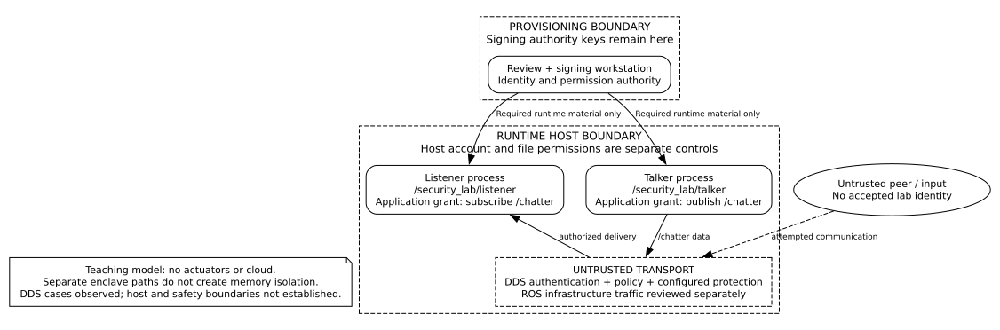

{:toc}

# {{ page.title }}

Original authors: {{ page.author }}

2026 revision, security review, and additional material: {{ page.revision_author }}

Originally written: {{ page.date_written }} · Revised: {{ page.revision_date }}

[Original article](security_history/183_ros2_threat_model.md.txt).

## Goal and prerequisites

Build a threat model that connects an attacker action to an asset, a trust boundary, a proposed control, and evidence needed to assess the remaining risk.
Read the security, policy, and enclaves chapters first.
You should be able to describe the robot's mission and its process/network architecture.

**Practical question:** An attacker steals a legitimate participant's key. Which controls still protect the robot, and what evidence would show that they work?
Encryption of traffic is only one part of the answer.

## Scope and edition status

The current worked model is a **non-actuating talker/listener teaching system** using the selected Jazzy/DDS configuration described in the first chapter.
It is a bounded example, not a proxy for a production robot.
Its policy can be checked offline; live communication and safety behavior require separate evidence.

The original TurtleBot 3 and MARA models used Crystal-era configurations and include third-party historical assessment results.
Those results and the original threat catalog are preserved in the [historical source](security_history/183_ros2_threat_model.md.txt) and [historical reader](../reports/security-review/security-reference-reader.pdf).
They are not evidence that a current platform is exploitable, fixed, or safe.
This revision replaces their role as the default implementation baseline while retaining their value as case studies.

## Model the system before scoring it

Record the mission, operator, deployment environment, approved maintenance paths, version inventory, and exclusions.
Separate known observations from assumptions.
For a robot, include actuators, sensors, embedded controllers, local administration, firmware updates, cloud services, and external data providers where they actually exist.

An **asset** is something to protect: control authority, availability, credentials, private data, software integrity, or human safety.
An **entry point** accepts influence: a DDS topic, a remote shell, a dashboard, USB, a sensor, or an update pipeline.
A **trust boundary** is where assumptions about identity, privilege, or enforcement change.
A dashed box on a diagram is only meaningful when an actual control enforces it.

### Worked architecture

The provisioning workstation signs identity/policy material.
The runtime system has separate talker and listener enclave paths and processes.
The application flow is `/chatter`; ROS infrastructure traffic must be accounted for separately.
The network is treated as untrusted even when the exercise runs on one host.
There are no actuators and no cloud dependencies in this model.

| Boundary | Assumption | Control and evidence required |
| --- | --- | --- |
| Provisioner → runtime | Authority private keys stay on the provisioner. | Deployment file inventory and service-account read checks. |
| Process → DDS network | Peers are authenticated and operations are authorized. | Reviewed governance/permissions plus positive and negative runtime cases. |
| Talker ↔ listener host resources | Processes cannot freely read each other's secrets. | OS identity/access design; this is not provided by enclave names. |
| Incoming message → application | Authenticated data can still be invalid. | Application validation and bounded processing; the toy listener does not establish robot safety. |

## Use STRIDE consistently

STRIDE is **Spoofing, Tampering, Repudiation, Information Disclosure, Denial of Service, and Elevation of Privilege**.
The original prose incorrectly used “Integrity” for the “I”; the corrected category is Information Disclosure.
Integrity remains an important security property, but it is not that category name.
See [Microsoft's STRIDE definitions](https://learn.microsoft.com/en-us/azure/security/develop/threat-modeling-tool-threats).

Apply the categories to the actual data flows and stores rather than treating the acronym as a complete list of robot hazards.
A threat can span multiple categories.
For example, stealing a key can lead to information disclosure and spoofing, while an authorized process flooding a control path can cause denial of service.

### Risk and evidence fields

Each current threat record includes an ID, attacker prerequisite, affected asset/boundary, scenario, control, verification action, owner role, treatment, evidence status, and residual-risk note.
An owner role in this teaching model is a responsibility to assign, not a named person who has accepted it.
Do not invent exploitation probabilities or percentages.

Use likelihood rationale and mission-specific impact for deployment decisions.
The original DREAD totals and MARA RVSS results remain historical annotations in the archive.
For a concrete vulnerability, CVSS can supplement severity discussion; it does not replace operational risk or a robot safety assessment.
[FIRST's CVSS 4.0 specification](https://www.first.org/cvss/v4.0/specification-document) includes safety-related metrics, but a number alone is not a safety argument.

Use these evidence states:

- **Proposed:** a design or test case exists, but no implementation evidence is supplied.
- **Offline-checked:** a file or transformation passed the named local check.
- **Runtime-observed:** a recorded software run produced the stated outcome on exact versions.
- **Bench-observed:** an isolated device run produced the stated outcome.
- **Robot-observed:** the stated behavior was observed on the identified physical system.
- **Historical:** a past assessment or design claim is retained with its original scope/date.

“Mitigated” requires an explanation of which attack path is blocked under which assumptions and what risk remains.
Do not convert a proposed mitigation into a completed result by changing the wording.

## Current teaching-system threat register

The canonical records are in [threat-register.json](https://github.com/Gh0stlyKn1ght/design/blob/gh-pages/examples/security-lab/threat-register.json).
Their full text is included in the updated handbook PDF.
The summary below is an index, not a replacement for the records.

| ID | Threat and prerequisite | Control / validation focus |
| --- | --- | --- |
| TM-001 | Untrusted participant attempts to inject `/chatter` data. | Authentication, governance admission and restrictive grants; untrusted-keystore case. |
| TM-002 | Authenticated listener attempts application publishing. | Direction-specific grants and default denial; inspect generated XML and test forbidden publish. |
| TM-003 | Missing or unreadable enclave material causes unsecured startup. | Deliberate enable/enforce settings; startup failure case. |
| TM-004 | Local attacker obtains an enclave private key. | OS/file boundaries, key replacement and isolation; review actual service-account access. |
| TM-005 | Authorized participant supplies excessive or invalid input. | Application bounds, resource controls and recovery; bounded load tests on the selected host. |
| TM-006 | Compromised update/provisioning path installs trusted malicious code or policy. | Reviewed signed inputs, artifact inventory, separate signing roles and recovery. |
| TM-007 | Logs/inspection reveal sensitive data or broaden access. | Separate inspection identity, retention/access policy and sanitized evidence. |
| TM-008 | Clock/expiry or credential change disrupts communication. | Validity checks, trusted time assumptions, renewal and restart/recovery tests. |

The offline checker supplies evidence only for relevant XML structure and grant-scope assertions. The recorded runtime run additionally observed application-write denial and missing-enclave failure, chiefly TM-002 and TM-003. See the [runtime observations](../reports/security-handbook/runtime-observations.md).
It does not execute the network attacks, establish confidentiality, or prove any robot is safe.
Every unexecuted runtime test remains **not run**.

## Validate claims with paired cases

Start with authorized communication on the same host/configuration.
Then vary one property at a time: enclave presence, trusted authority, topic permission, or application input.
Record exit code, sanitized logs, actual message delivery, elapsed observation window, and exact versions.
Use logs and a positive control to distinguish rejection from a broken network or a QoS/type mismatch.

For packet inspection, define which interface and flows were captured, which protection settings were enabled, and what was visible.
Not seeing plaintext in one capture is not proof that every channel or metadata field is confidential.
Avoid capturing unrelated users' traffic or retaining credentials in shared evidence.

Tests that can affect motion belong on a separately bounded hardware test plan with an independent stop mechanism and recovery procedure.
The provided non-actuating lab does not issue movement commands.

## Extend the model to an actual robot

1. Name the robot, firmware, OS, ROS distribution, RMW, middleware/security libraries, packages, topology and mission.
2. Inventory operators, remote support, provisioning, cloud connections, sensors, actuators, buses and update sources.
3. Draw data flows, stores and actual enforcement boundaries; identify safety-critical paths separately.
4. Start from the historical threat catalog and current records, then remove irrelevant assumptions and add deployment-specific scenarios.
5. Assign owner roles and treatment: reduce, avoid, transfer or explicitly accept with an accountable decision and review date.
6. Pair each control with authorized and rejected cases, recovery observations, evidence location and a residual-risk statement.
7. Revisit the model after architecture, privilege, firmware, policy, or exposure changes.

### Host, network and supply chain

Use supported software, minimal service privileges, credential separation, reviewed network paths and a defined update process.
Record build inputs and dependencies; an SBOM is an inventory aid, not proof that software is trustworthy.
Verify update signatures before installation, protect signing keys, and design recovery and rollback deliberately.
A validly signed malicious or vulnerable update remains possible when the signing/provisioning authority is compromised.

ROS bridges, dashboards, VPN gateways, microcontroller agents, serial links and CAN buses each create their own boundary.
Identify where authentication/encryption terminate and whether a bridge can republish into a more trusted domain.
Do not assume DDS protection extends across a non-DDS link.

### Safety, privacy and optional AI

A robot needs appropriate command validation, stale-input handling, watchdog/degraded-mode behavior, resource limits and independent stop controls.
Security and functional safety share some failure consequences but require their own evidence.
The absence of a reported vulnerability is not proof that movement is safe.

Record what sensor/log data is collected, who can access it, retention and deletion, and what is exported off the robot.
If the system uses learned perception or language-model tools, model untrusted inputs, sensor deception, tool authority and output validation as additional flows.
Do not add AI-specific controls to a system that has no such component merely to make the model look modern.

## Exercise, artifact and next step

Use the supplied threat-record format to model one maintenance operation, such as a policy renewal or software update.
Draw the boundary, write an attacker prerequisite, propose a control, and state exactly what observation would support the claim.
Leave its status proposed until that evidence exists.

**Artifact:** mission/scope sheet, diagram, threat register, version manifest and evidence log.

**Explain back:** Which threats remain after enabling encryption? What changes when two components share a process? Why is a historical MARA finding not automatically a finding on your robot?

**Misconceptions:** a scanner's clean result is not a complete threat model; a risk score is not a test result; a planned control is not implemented evidence; authentication does not establish safe command semantics.

**Limit:** this edition includes documentation review, offline validation, and bounded software runtime observations. Six ROS cases passed; the separate-authority case is inconclusive. No physical robot validation was performed.
Next, repeat the bounded lab on the target deployment and attach its observations before extending any claim to that system.

## Sources and historical attribution

- [Original ROS 2 threat model at the reviewed revision](https://github.com/ros2/design/blob/93a415bf928751d37fce6f83215c521658e20c93/articles/183_ros2_threat_model.md).
- [Microsoft STRIDE](https://learn.microsoft.com/en-us/azure/security/develop/threat-modeling-tool-threats).
- [FIRST CVSS 4.0](https://www.first.org/cvss/v4.0/specification-document).
- [OWASP Threat Dragon](https://www.threatdragon.com/docs/) for optional collaborative/local model editing.
- [Current security tooling choices](../reports/security-handbook/technology-choices.md).

Original threat-model authors remain credited above.
The MARA assessment described in the archive was performed by Alias Robotics for the named historical system; this fork's revision is not a new assessment of that platform.
